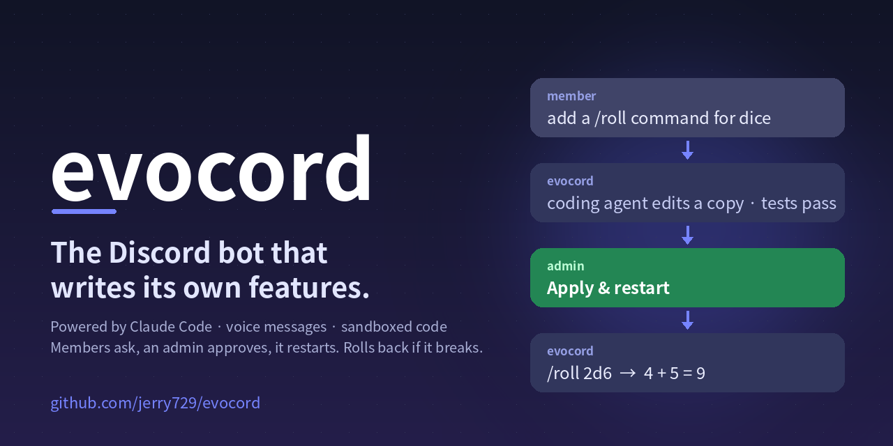

<p align="center">
  
</p>

<p align="center">
  <a href="https://github.com/jerry729/evocord/actions/workflows/ci.yml"></a>
  <a href="https://github.com/jerry729/evocord/releases"></a>
  <a href="LICENSE"></a>
</p>

# evocord

**Your Discord members ask for a feature. The bot writes it, an admin clicks Apply, and it restarts with the
feature. If the new version breaks, it rolls back by itself.**

evocord is a self-hosted Discord bot built on [Claude Code](https://code.claude.com) and its
[channels](https://code.claude.com/docs/en/channels) feature. It:
- chats like a member of your server and can stay quiet until it has something useful to say;
- searches the web;
- understands voice messages;
- runs code in a sandbox and posts the charts and files it makes;
- grows new abilities when people ask for them.

> evocord is an independent community project. It is not affiliated with or endorsed by Anthropic or Discord.

## See it in action

<!-- demo: replace with docs/assets/demo.gif once recorded -->

*An illustrative transcript of the self-update flow. The message formats are the bot's real ones; a screen
recording is coming.*

```text
👤 alice     @evocord add a /roll command, like /roll 2d6
🤖 evocord   🧬 Self-update job `k3x9` · writing code · 1m12s
             ✏️ channel/server.ts  ✏️ channel/dice.ts  $ bun test
🤖 evocord   🧬 Self-update proposal `k3x9` (requested by alice)
             channel/dice.ts | 61 +++++  channel/server.ts | 24 ++  CLAUDE.md | 2 +
             Checks: ✅ type check and tests passed        [✅ Apply & restart] [🗑️ Discard]
👑 admin     *clicks Apply*
🤖 evocord   ♻️ Merged as `4f2a91c0`, restarting…
🤖 evocord   ✅ Update `k3x9` is live, now on `4f2a91c0`
👤 alice     /roll 2d6
🤖 evocord   🎲 4 + 5 = **9**
```

Real self-updates from real servers, with the requests, diffs, time and cost: **[Evolution gallery](docs/evolution-gallery.md)**.

## Why evocord

- **The server shapes its own bot.** Ask for a feature in chat and it gets built. Admins review every change as a
  diff and approve it with one click.
- **It does things, not just talks.** It runs real code for real answers: numbers, charts, converted files. It reads
  links, hears voice messages, and remembers your server's conventions.
- **Built to be poked at.** Anyone in the channel can attempt prompt injection, so the boundaries are enforced outside
  the model: no shell for the bot, a Docker sandbox for code, server-side permission checks, admin-only apply, and
  automatic rollback.
- **Yours.** It runs on your machine with your Claude subscription. Chats, memory and code stay with you.

## Features

- 💬 **Natural chat** — answers @-mentions and replies, or (per channel) reads everything and decides by itself
  when to join in.
- 🔎 **Web search & browsing** — Claude Code's WebSearch / WebFetch plus a headless Playwright browser for
  JavaScript-heavy pages and screenshots.
- 🎙️ **Voice messages** — Discord voice messages are transcribed locally with
  [faster-whisper](https://github.com/SYSTRAN/faster-whisper) (GPU if available) before the model sees them; other
  audio/video attachments on request.
- 🧪 **Runs code** — Python / bash / Node in a locked-down Docker sandbox: calculations, data analysis, charts,
  file conversion (ffmpeg), API calls. Generated files are posted back to the chat.
- 🧬 **Self-evolution** — "add a command that …" → coding agent → diff + Apply/Discard buttons → restart → automatic
  rollback on failure. Members can propose; admins approve.
- 🧠 **Long-term memory** — Markdown notes about people, channels and topics.
- ♻️ **Resilient** — a supervisor restarts the session, resumes the conversation, and catches up on messages missed
  during restarts.
- 🛡️ **Least privilege** — no shell for the chat model, server-side permission checks, tokens kept out of reach.
  See [Security model](#security-model).

## How it works

```
Discord ──▶ channel/server.ts (Bun MCP "channel" server) ──<channel> events──▶ Claude Code session (CLAUDE.md persona)
             │  access control: channels / users / admins    ◀── reply · run_code · transcribe · self_update ──┘
             ├─ voice.ts   → tools/transcribe.py (faster-whisper)
             ├─ sandbox.ts → docker run evocord-sandbox
             └─ evolve.ts  → claude -p in a git worktree → diff → admin clicks Apply → merge → restart
supervisor.py: runs claude in a pty, answers its startup prompt, restarts it, rolls back failed updates
```

The chat session itself has no shell. Everything it can do in Discord goes through the tools of the channel server,
which checks who asked before acting. Architecture details: [DEVELOPING.md](DEVELOPING.md).

## Requirements

| | |
| --- | --- |
| OS | Linux (tested on Ubuntu 24.04 and WSL2). macOS should work but is untested. |
| Claude | [Claude Code](https://code.claude.com) ≥ 2.1.80 (tested with 2.1.330), logged in with a claude.ai **Pro / Max** account or a Console API key. **Team / Enterprise**: an org owner must enable *Channels* (Organization settings → Claude Code → Channels). Channels are not available on Bedrock / Vertex / Foundry. |
| Tools | git, Python ≥ 3.9, tmux, curl. `setup.sh` installs [Bun](https://bun.sh), Claude Code and [uv](https://docs.astral.sh/uv/) if missing. |
| Docker | Needed for `run_code` and for checking self-update proposals. Your user must be able to run `docker ps`. |
| GPU | Optional. An NVIDIA GPU makes transcription ~10× faster; CPU works with a smaller model. |
| Disk | ~6 GB with everything (Whisper env + model ≈ 4 GB, sandbox image ≈ 1.4 GB). |

The machine must stay on: the bot is a process on your computer, VM or VPS.

> [!NOTE]
> Claude Code channels are a **research preview**. Custom channels like evocord's are loaded with
> `--dangerously-load-development-channels`, and the protocol may change between Claude Code releases. evocord is
> tested with the version above; if an update breaks it, please open an issue.

## Setup

### 1. Create the Discord bot

1. Open the [Discord Developer Portal](https://discord.com/developers/applications) → **New Application**, give it a name.
2. Open the **Bot** page:
   - Click **Reset Token** and copy the token (you need it in step 4; it is shown only once).
   - Under **Privileged Gateway Intents**, enable **MESSAGE CONTENT INTENT** and click **Save Changes**.
     Without it the bot receives empty messages.
   - Optional but recommended: turn off **Public Bot** so only you can add it to servers.

### 2. Install

```bash
git clone https://github.com/jerry729/evocord.git
cd evocord
./scripts/setup.sh          # add --no-voice / --no-sandbox / --no-browser to skip parts
```

This installs dependencies, creates `.venv` with faster-whisper and downloads the Whisper model, builds the
`evocord-sandbox` Docker image, creates `config/bot.json` from the example, and runs the test suite.

### 3. Log in to Claude Code

The bot uses whatever account the `claude` CLI is logged in with. To check, run `claude auth status`. If you're not
logged in, run `claude` once, type `/login`, then `/exit`.

**Recommended: give the bot its own login** so its usage and your own Claude Code usage stay separate (and switching
accounts in your terminal never affects the bot):

```bash
cd evocord
CLAUDE_CONFIG_DIR=~/.claude-evocord claude     # pick a theme, /login with the bot's account, trust the folder, /exit
```

then set `"runtime": { "claudeConfigDir": "~/.claude-evocord" }` in `config/bot.json` (step 5). The self-update agent
uses the same account.

### 4. Save the token and invite the bot

```bash
./scripts/set-token.sh
```

Paste the token from step 1 (input is hidden). The script checks it against Discord and saves it to
`~/.config/evocord/.env` (mode 600, outside the bot directory so the bot cannot read it). It also warns you if the
Message Content Intent is off, and prints an **invite link**. Open the link, pick your server and authorize. The link
requests the permissions the bot needs: View Channels, Send Messages, Send Messages in Threads, Read Message History,
Attach Files, Embed Links, Add Reactions.

### 5. Configure

Turn on Discord **Developer Mode** (User Settings → Advanced → Developer Mode). Then:
- **Your user ID**: click your avatar → *Copy User ID*.
- **Channel ID**: right-click a channel → *Copy Channel ID*.

Edit `config/bot.json`:

```json
{
  "admins": ["123456789012345678"],
  "channels": {
    "234567890123456789": { "requireMention": true,  "allowFrom": [] },
    "345678901234567890": { "requireMention": false, "allowFrom": [] }
  },
  "sandbox": { "allow": "everyone" },
  "evolve":  { "allow": "admins" },
  "runtime": { "model": null, "effort": null, "claudeConfigDir": null }
}
```

- `requireMention: true`: the bot only sees messages that @-mention it, reply to it, or match `mentionPatterns`.
- `requireMention: false`: the bot sees every message in that channel and decides when to speak. This is more lively
  and uses more quota.

Threads inherit their parent channel's settings. The full list of keys is in
[Configuration reference](#configuration-reference). The file is re-read automatically; only `runtime` needs a
restart.

### 6. Start

```bash
./scripts/start.sh            # starts the supervisor in tmux session "evocord"
tmux attach -t evocord        # watch it; Ctrl-b d detaches without stopping
```

On the **first** start, Claude Code may ask you to **trust the folder** (choose *Yes*) or to **log in**. Attach and
answer once. After that every restart, including those after self-updates, runs unattended. The supervisor answers
the "Loading development channels" prompt that Claude Code shows at every launch.

### 7. Check that it works

- `state/logs/channel.log` should contain `gateway connected as <your bot>`.
- In your channel:
  - `@yourbot hi`
  - `@yourbot what's new in AI today?` — it searches the web and cites sources.
  - Send a **voice message** — it is transcribed and answered.
  - `@yourbot plot y = sin(x)/x and send me the image` — the code runs in the sandbox and the PNG is posted.
  - `!bot status` (admins) — shows the version, uptime and settings.

Stop with `./scripts/stop.sh`. To start at boot, use [`scripts/evocord.service`](scripts/evocord.service) (systemd
user service; instructions inside).

## Using it

### Self-evolution

1. Someone allowed by `evolve.allow` asks: *"@yourbot add a `/roll 2d6` dice command"* or *"from now on keep your
   answers under five sentences — put it in your rules"*.
2. The bot calls `self_update`. The server checks the author of that message and starts a coding agent on a copy of
   the code (a git worktree outside the live directory). Progress is posted to the channel.
3. A **proposal** appears with:
   - a diff stat and the full diff as an attachment;
   - the results of the type check and tests (always run inside the Docker sandbox);
   - a warning if sensitive files changed (permissions, sandbox, access control, supervisor, persona…);
   - **Apply & restart** and **Discard** buttons.
4. Anyone allowed can @ the bot with feedback ("make the dice emoji bigger") to revise the same proposal.
5. An admin clicks **Apply**. The change is merged and the bot restarts with its conversation intact, then announces
   the new version. If the new version doesn't come up within 3 minutes, the supervisor rolls back to the previous
   version and says so.

Changes are recorded in a private history repo (`state/history.git`, separate from the repository you cloned).
Admins can inspect it with `!bot log` and undo with `!bot rollback [commit]`.

### Admin commands

These come from admins listed in `config/bot.json`. The server handles them directly and never shows them to the
model, so they work even if the model or its prompt is broken.

| Command | |
| --- | --- |
| `!bot status` | version, uptime, enabled features, running / pending self-update jobs |
| `!bot restart` | restart the Claude session (conversation context kept) |
| `!bot reset` | restart with a fresh conversation (memory files kept) |
| `!bot evolve <request>` | start a self-update without going through the model |
| `!bot jobs` · `!bot diff <id>` | list jobs · fetch a proposal's diff |
| `!bot apply <id>` · `!bot discard <id>` | same as the buttons |
| `!bot log` · `!bot rollback [commit]` | code history · roll back (default: undo the last update) and restart |

## Configuration reference

`config/bot.json` (copied from [`config/bot.example.json`](config/bot.example.json); not version-controlled):

| Key | Default | Meaning |
| --- | --- | --- |
| `admins` | `[]` | User IDs with admin rights: apply self-updates, `!bot` commands, DMs |
| `dmAllowFrom` | `[]` | Non-admins allowed to DM the bot |
| `channels.<id>.requireMention` | `true` | `false` = deliver every message; the bot decides when to speak |
| `channels.<id>.allowFrom` | `[]` | Restrict a channel to these user IDs (empty = everyone; admins always allowed) |
| `mentionPatterns` | `[]` | Regexes that count as a mention, e.g. `"^claude[,:\\s]"` |
| `ackReaction` | `"👀"` | Reaction added when the bot is addressed (`""` disables) |
| `adminPrefix` | `"!bot"` | Prefix of admin commands |
| `voice.enabled` | `true` | Transcribe voice messages |
| `voice.model` | `"large-v3-turbo"` | Whisper model; `small` or `base` for CPU-only machines |
| `voice.device` | `"auto"` | `auto` / `cuda` / `cpu` |
| `voice.language` | `null` | Force a language (e.g. `"en"`); `null` = auto-detect |
| `voice.initialPrompt` | `null` | Prompt to bias transcription (spelling, script, jargon) |
| `sandbox.enabled` | `true` | Enable `run_code` |
| `sandbox.allow` | `"everyone"` | Who may run code: `"everyone"`, `"admins"` or a list of user IDs |
| `sandbox.network` | `"bridge"` | `"none"` cuts the sandbox off from the network |
| `sandbox.timeoutSec` / `maxTimeoutSec` | `60` / `600` | Default / maximum run time |
| `sandbox.memory` / `cpus` | `"1g"` / `"2"` | Container limits |
| `evolve.enabled` | `true` | Enable self-updates |
| `evolve.allow` | `"admins"` | Who may *request and revise* proposals: `"admins"`, `"everyone"` or user IDs. Applying always needs an admin. |
| `evolve.dailyLimit` | `5` | Max agent runs per non-admin per 24 h |
| `evolve.model` | `null` | Model for the coding agent (`null` = account default) |
| `evolve.timeoutMin` / `maxBudgetUsd` | `30` / `null` | Limits per agent run |
| `evolve.autoApply` | `false` | Apply admin-requested proposals without a click when checks pass and nothing sensitive changed |
| `catchup.enabled` / `maxAgeMin` / `maxMessages` | `true` / `30` / `30` | Deliver messages missed during restarts |
| `runtime.model` / `effort` | `null` | Model and effort for the chat session, e.g. `"claude-opus-5-5"`, `"high"` |
| `runtime.claudeConfigDir` | `null` | Claude config dir (= account) for the bot; `null` = `~/.claude` |

Other files you may want to edit: [`CLAUDE.md`](CLAUDE.md), the bot's persona and rules, and
[`sandbox/Dockerfile`](sandbox/Dockerfile), the packages available to `run_code`. Members can also ask the bot to
change either through self-evolution.

## Security model

Anyone who can talk to the bot can try prompt injection, so the design assumes the model *can* be talked into
things. The hard limits are enforced outside the model:

- **No shell for the chat model.** `Bash` is denied. Code only runs via `run_code` in Docker with:
  - `--cap-drop ALL`, `no-new-privileges`;
  - memory, CPU, pid and time limits;
  - your uid;
  - only that channel's work directory mounted.

  The sandbox has internet access by default, which means it can also reach your local network. Use
  `sandbox.network: "none"` or `sandbox.allow: "admins"` if that matters to you.
- **Isolated settings.** The session starts with `--setting-sources ""` and only
  [`config/runtime-settings.json`](config/runtime-settings.json): none of your personal Claude Code permissions,
  hooks, plugins or claude.ai connectors. It can write only `memory/` and `workspace/`. It cannot read the token,
  `config/bot.json`, `~/.ssh` or `~/.claude*`.
- **Server-side identity checks.** Admin status, who may run code and who may request self-updates are checked
  by the server against Discord data: the author of the referenced message, or the user who clicked the button.
  Message text and tool arguments are never trusted for this.
- **Self-updates are proposals.**
  - The coding agent edits a worktree copy. It cannot write the live directory or read state or secrets.
  - For requests from non-admins it gets **no shell at all**.
  - Every proposal's tests run inside the Docker sandbox: offline, with only the worktree and read-only
    dependencies mounted. Nothing from a proposal runs on the host before an admin approves it.
  - Applying requires an admin. Approving a change means trusting that code with your user account, so read the
    diff, especially when it is flagged as touching sensitive files.
- Attachments sent by the bot can only come from `state/inbox`, `state/sandbox` or `workspace`. The bot never pings
  @everyone, @here or roles.
- Access control (`config/bot.json`) is outside version control and cannot be changed from chat.

Run it on a dedicated machine, VM or user account, not next to sensitive personal data or production credentials.

## Costs and quotas

All usage counts against the Claude account the bot is logged in with:
- every delivered message (channels with `requireMention: false` deliver all of them, even when the bot stays quiet);
- every tool call;
- every self-update agent run.

Use a cheaper `runtime.model`, `requireMention: true` and a low `evolve.dailyLimit` to keep it in check. A separate
account via `runtime.claudeConfigDir` keeps the bot from eating into your own quota.

## Operations

- **Logs**: `state/logs/supervisor.log` (restarts, rollbacks), `state/logs/channel.log` (gateway, tools, errors). The
  console output of headless (systemd) runs goes to `state/logs/console.log`.
- **Data**: `memory/`, `workspace/` and `state/` are data. Updates and rollbacks never touch them; back them up if you
  care about them.
- **Hand edits**: edit the code directly and send `!bot restart`. The next self-update snapshots your edits into the
  history first.
- **Upgrading from upstream**:
  1. `git pull`
  2. `bun install`
  3. if `sandbox/Dockerfile` changed: `docker build -t evocord-sandbox sandbox`
  4. `./scripts/stop.sh && ./scripts/start.sh`

  Self-evolved changes live in your working tree; commit them to a branch first if you want to keep them across
  pulls.
- **Changing `supervisor.py`** takes effect only after `./scripts/stop.sh && ./scripts/start.sh`. Self-updates never
  restart the supervisor itself.

## Troubleshooting

| Symptom | Fix |
| --- | --- |
| Bot is online but never answers | Message Content Intent off (rerun `set-token.sh` to check); channel ID missing from `config/bot.json`; with `requireMention: true` you must @ it. Check `state/logs/channel.log`. |
| `channel.log` has no `gateway connected` | Token missing or wrong: rerun `./scripts/set-token.sh`. |
| tmux shows the login or theme screen | Attach and finish it once (`tmux attach -t evocord`). Using `runtime.claudeConfigDir`? Log in for that directory as shown in step 3. |
| "trust this folder" dialog after moving the directory | Attach and accept. To accept it automatically, start with `BOT_AUTO_TRUST=1 ./scripts/start.sh`. |
| Channels don't work on a Team/Enterprise account | An org owner must enable Channels in the Claude organization settings. |
| `run_code` fails with a docker error | Run `docker ps` as the bot's user and fix permissions, then build the image: `docker build -t evocord-sandbox sandbox`. |
| Voice transcription fails or is slow | Check `.venv` exists (`./scripts/setup.sh`). Without a GPU, set `voice.model: "small"`. The first use downloads the model. |
| A self-update was rolled back | `state/logs/supervisor.log` gives the reason. The proposal's diff is still available via `!bot diff <id>`. |
| Bot stopped replying after weeks | The Claude login may have expired: attach and `/login`. |

## Development

```bash
bun run check                            # TypeScript type check
bun test                                 # unit + smoke tests (no Discord, token, GPU or network needed)
python3 -m unittest discover -s tests    # supervisor tests
```

See [DEVELOPING.md](DEVELOPING.md) for the architecture, how to add tools, and the security invariants that changes
must keep. Contributions are welcome, see [CONTRIBUTING.md](CONTRIBUTING.md).

## Community

- Questions, ideas, show-and-tell of what your bot evolved into: [Discussions](https://github.com/jerry729/evocord/discussions)
- Bugs and feature requests: [Issues](https://github.com/jerry729/evocord/issues). Security problems: see [SECURITY.md](SECURITY.md).
- Want to help? Look for [good first issues](https://github.com/jerry729/evocord/labels/good%20first%20issue).

If evocord is useful to you, a ⭐ helps other people find it.

## License

[Apache License 2.0](LICENSE)
